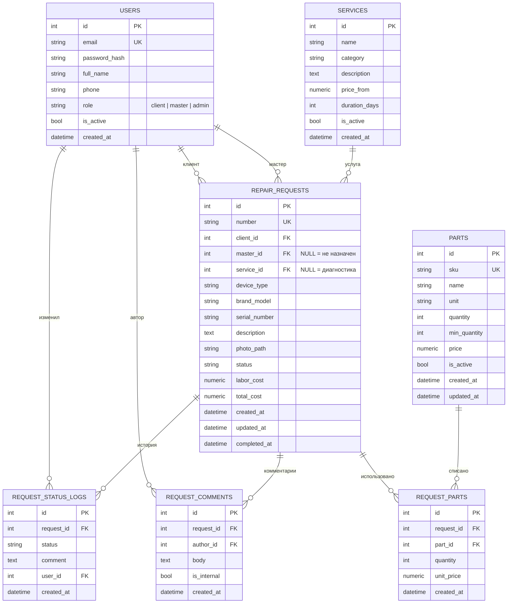

# Модель данных

СУБД — SQLite. Схема создаётся SQLAlchemy из моделей `app/models.py`; внешние ключи включены через `PRAGMA foreign_keys=ON`.

## ER-диаграмма

## Таблицы

### `users`
Пользователи всех ролей. `email` уникален, `role` принимает `client`, `master`, `admin`. `is_active = 0` блокирует вход, но сохраняет историю заявок. Пароль хранится как `pbkdf2_sha256$итерации$соль$хеш`.

### `services`
Каталог услуг. `price_from` — ориентировочная цена «от», `duration_days` — плановый срок. `is_active = 0` скрывает услугу из каталога и выбора в новой заявке, но оставляет её в старых заявках.

### `parts`
Склад запчастей. `sku` уникален. `quantity` — текущий остаток, `min_quantity` — порог предупреждения (`quantity <= min_quantity`). Остаток меняется мастером при списании и администратором операциями прихода/списания.

### `repair_requests`
Заявка на ремонт. `number` формата `RM-ГГГГ-0001` уникален. `master_id = NULL` — заявка ещё не распределена. `status` — одно из значений: `accepted`, `diagnostics`, `in_repair`, `ready`, `issued`, `cancelled`. `labor_cost` — работы, `total_cost` = работы + сумма запчастей (пересчитывается при изменениях).

### `request_status_logs`
Журнал переходов: кто и когда изменил статус, с каким комментарием. Используется для таймлайна в карточках и аудита.

### `request_comments`
Комментарии мастера и администратора. `is_internal = 1` — внутренняя заметка, клиенту не показывается.

### `request_parts`
Фактически использованные запчасти. `unit_price` фиксирует цену на момент списания, поэтому изменение прайса склада не искажает стоимость старых заявок. Пара `(request_id, part_id)` уникальна — повторное добавление увеличивает количество существующей строки.

## Ограничения целостности

| Ограничение | Реализация |
| --- | --- |
| Уникальность e-mail | `users.email UNIQUE` |
| Уникальность артикула | `parts.sku UNIQUE` |
| Уникальность номера заявки | `repair_requests.number UNIQUE` |
| Одна строка запчасти на заявку | `UNIQUE(request_id, part_id)` |
| Каскадное удаление истории | `ON DELETE CASCADE` для журналов, комментариев и запчастей заявки |
| Запрет удаления клиента с заявками | `ON DELETE RESTRICT` для `client_id` |
| Сохранение заявки при удалении мастера/услуги | `ON DELETE SET NULL` |
| Запрет удаления используемой запчасти | `ON DELETE RESTRICT` для `part_id` |
| Допустимые статусы и роли | проверка на уровне приложения (`constants.py`, валидаторы роутеров) |
| Неотрицательные цены и остатки | валидация `parse_money`, `parse_positive_int`, проверки склада |

## Индексы

- `ix_repair_requests_status` — фильтры списков заявок;
- `ix_repair_requests_client`, `ix_repair_requests_master` — кабинеты клиента и мастера;
- `ix_repair_requests_created_at` — сортировка и статистика по датам;
- уникальные индексы по `email`, `sku`, `number`.